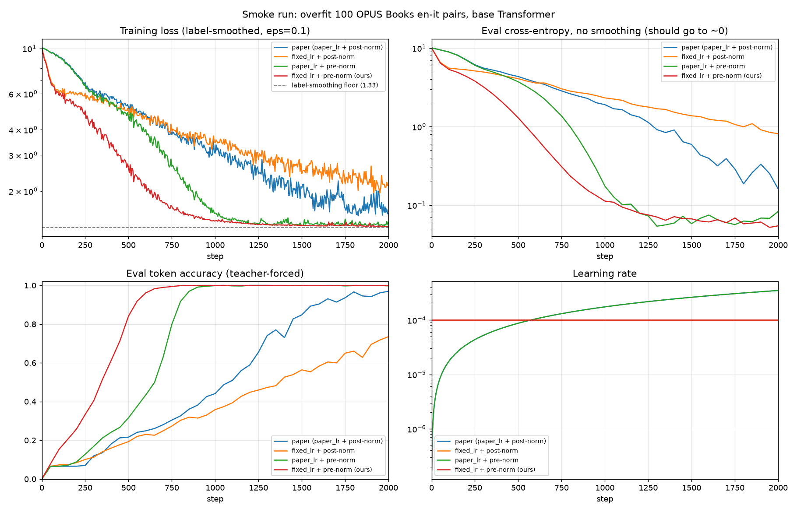

# Smoke run 2026-11-18_190701

Overfit 100 OPUS Books en-it sentence pairs with the base
Transformer to prove the wiring. Baseline = the paper's setup; other variants flip one variable at a time
(the last flips both = our default config).

- Steps per variant: 2000 (batch size 10, 10 steps/epoch)
- seq_len: 32, vocab: src 15698 / tgt 22463
- Label-smoothing loss floor (lowest possible training loss with eps=0.1): **1.327**
- Device: mps, torch 2.15.0, seed 0
- Git commit: `0af772023c3a66a37f7aa64f4ebb3ba9e94af154` (uncommitted changes: yes, see code/uncommitted.diff)

## Results

| Variant | Overrides | Final train loss | Eval CE (unsmoothed) | Token acc | Greedy exact match | Step CE < 0.05 | Diverged | Time |
|---|---|---|---|---|---|---|---|---|
| paper (paper_lr + post-norm) | `{"use_paper_lr_schedule": true, "pre_norm": false}` | 1.544 | 0.1603 | 97.0% | 72/100 | never | no | 234s |
| fixed_lr + post-norm | `{"use_paper_lr_schedule": false, "pre_norm": false}` | 2.127 | 0.8115 | 73.5% | 19/100 | never | no | 240s |
| paper_lr + pre-norm | `{"use_paper_lr_schedule": true, "pre_norm": true}` | 1.404 | 0.0831 | 99.7% | 96/100 | never | no | 243s |
| fixed_lr + pre-norm (ours) | `{"use_paper_lr_schedule": false, "pre_norm": true}` | 1.342 | 0.0544 | 100.0% | 100/100 | never | no | 237s |



## Files

- `meta.json`: command, environment, git, data selection
- `pairs.json`: the exact sentence pairs (with their index in the dataset)
- `tokenizers/`: tokenizers used (`<lang>.json`)
- `code/`: snapshot of all `.py` files at run time, plus `uncommitted.diff`
- `variants/<name>/config.json`: fully resolved config for that variant
- `variants/<name>/metrics.json`: summary + every logged train step + every eval
- `variants/<name>/predictions.json`: greedy decode of every pair vs. reference
- `variants/<name>/tensorboard/`: view with `../.venv/bin/tensorboard --logdir experiments/smoke_run/2026-11-18_190701/variants`
- `plots/`: loss / CE / accuracy / learning-rate curves
- `log.txt`: console output

## Reproduce

```
cd transformer-from-scratch
git checkout 0af772023c3a66a37f7aa64f4ebb3ba9e94af154   # then apply code/uncommitted.diff, or copy code/*.py over
../.venv/bin/python smoke_run.py --steps 2000
```
